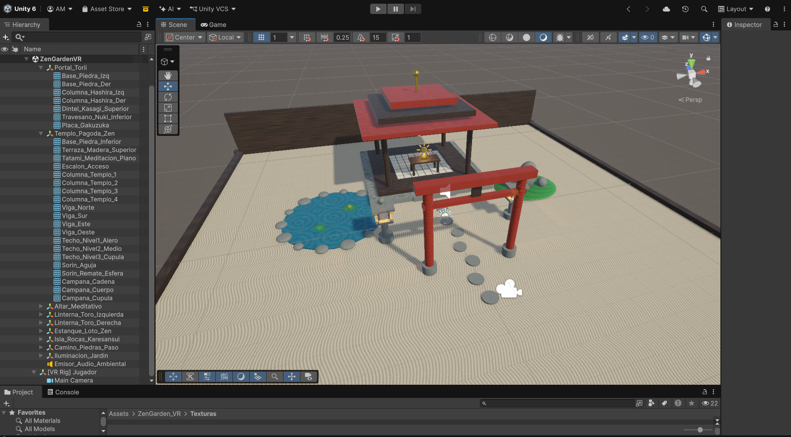
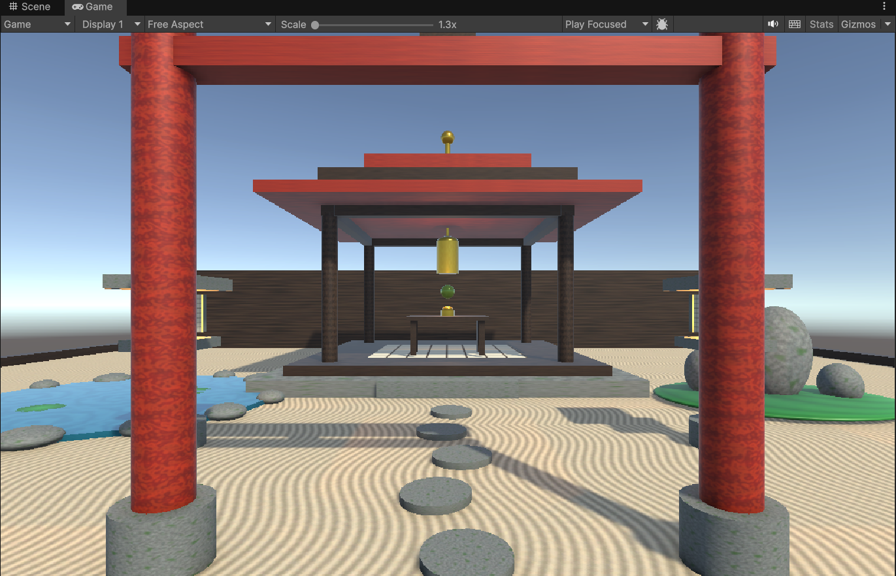

# Zen Garden VR: Entorno Inmersivo Contemplativo y Templo Meditativo a Escala Humana 1:1

**Documento de Entrega para Evaluación Entre Pares (Peer Review)**  
**Curso:** Realidad Virtual  
**Entorno de Desarrollo:** Unity 6 / URP (Universal Render Pipeline)  
**Estándar XR:** OpenXR / Unity Input System (XR Tracked Pose Driver)  

---

## 1. Título del Proyecto

> **Zen Garden VR: Santuario Contemplativo Japonés y Templo Meditativo a Escala Humana (1:1)**

<p align="center">
  
</p>

---

## 2. Breve Descripción de la Escena

Este proyecto presenta un entorno 3D **imaginario y contemplativo** inspirado en los jardines zen tradicionales japoneses (*Karesansui*) y la arquitectura sagrada de templos budistas y santuarios sintoístas. El espacio está diseñado específicamente para promover estados de relajación, introspección y meditación guiada en Realidad Virtual.

### Composición Arquitectónica y Espacial del Entorno:
1. **Patio Central de Arena Zen (*Karesansui*):** Una amplia explanada de $24\times24\text{ m}$ con patrones de rastrillado zen concéntricos y ondulados, confinada por vigas perimetrales de madera oscura de teca y un muro zen de fondo.
2. **Sendero de Piedras de Paso (*Tobi-Ishi*):** Siete losas de piedra que guían de manera natural el recorrido visual y la atención del usuario desde el punto de inicio hacia el santuario.
3. **Portal Ceremonial Torii:** Entrada ceremonial tradicional de $3.8\text{ m}$ de altura que demarca la transición del mundo secular al espacio sagrado, compuesta por bases cilíndricas de piedra, dos grandes columnas de cedro rojo (*Hashira*), un dintel curvado superior (*Kasagi*), travesaño secundario (*Nuki*) y una placa votiva (*Gakuzuka*).
4. **Templo / Pagoda Meditativa de Tres Niveles:** Estructura arquitectónica de $7.2\times7.2\text{ m}$ de base con plataforma escalonada de piedra y madera, tatami ceremonial, cuatro columnas maestras, vigas estructurales, aleros voladizos escalonados, aguja sagrada (*Sōrin*) con remate de esfera dorada y una gran campana zen de bronce (*Bonshō*) suspendida del techo.
5. **Altar Zen Central:** Mesa de ofrendas elevada ($0.85\text{ m}$ de altura) con quemador de incienso (*Kōrō*), iluminación puntual cálida y un **orbe espiritual flotante** con material emisivo que rota suavemente en el eje Y.
6. **Farolas Gemelas de Piedra (*Tōrō*):** Ubicadas a ambos lados del camino, compuestas por base (*Kiso*), fuste (*Sao*), repisa (*Chūdai*), cámara de luz translúcida de papel *Shoji* (*Hibukuro*) con fuentes de luz puntual internas, tejadillo (*Kasa*) y remate joya (*Hōju*).
7. **Estanque de Lotos y Carpas:** Lámina de agua circular reflectante de $5\text{ m}$ de diámetro rodeada por 14 rocas perimetrales, con hojas de loto flotantes y una flor de loto central.
8. **Isla de Rocas Zen (*Iwakura*):** Montículo de musgo orgánico que alberga una tríada de piedras de meditación asimétricas (Piedra Padre, Piedra Guardián y Piedra Hijo) con orientaciones naturales.

---

## 3. Instrucciones Detalladas para los Evaluadores

Siga estos sencillos pasos para cargar, verificar y experimentar la escena correctamente:

### Paso 1: Abrir el Proyecto en Unity Hub
1. Abra **Unity Hub**.
2. Haga clic en **Add** (Añadir) > **Add project from disk** y seleccione la carpeta raíz del proyecto descomprimido.
3. Abra el proyecto con **Unity 6 (6000.x)** o **Unity 2022.3 LTS / 2023.x** con el paquete Universal Render Pipeline (URP).
4. Espere a que Unity finalice la importación inicial de paquetes y activos.

### Paso 2: Cargar la Escena de Evaluación
1. En la ventana **Project** (inferior), diríjase a la ruta:
   ```text
   Assets / Scenes / ZenGardenVR.unity
   ```
2. Haga doble clic en **`ZenGardenVR.unity`** para abrir la escena en el Editor.  
   *(Nota de respaldo: Si desea regenerar la escena completa desde cero en cualquier momento, puede ir al menú superior de Unity: `Herramientas VR` > `Generar Escena Completa`).*

### Paso 3: Verificar la Configuración de OpenXR
1. En la barra superior, acceda a **Edit** > **Project Settings...**
2. En la columna izquierda, seleccione **XR Plug-in Management**.
3. En la pestaña con el icono de monitor de PC (**Windows, Mac, Linux settings**):
   * Verifique que la casilla **OpenXR** esté seleccionada / marcada.
   * *(Opcional)* Despliegue el submenú **OpenXR** dentro de *XR Plug-in Management* y confirme que los perfiles de interacción deseados (ej. *Oculus Touch Controller Profile*, *HTC Vive Controller Profile* o *Eye Gaze / Head Pose Interaction*) estén activos.

### Paso 4: Ejecutar y Probar la Escena
1. En la parte superior central del editor de Unity, pulse el botón **Play (▶)**.
2. Comprobaciones inmediatas:
   * **Seguimiento de Cabeza (*Head Tracking*):** Si utiliza un visor VR o el simulador de dispositivos XR de Unity, mueva la cabeza para verificar el seguimiento posicional y rotacional completo 6DoF a través del componente `TrackedPoseDriver`.
   * **Animación Procedural:** Observe cómo el orbe/cristal zen situado sobre el altar rota continuamente con suavidad en su eje vertical Y.
   * **Audio Inmersivo:** Escuchará de inmediato el tono armónico ambiental continuo generado proceduralmente (frecuencias sagradas de cuenco tibetano: 216 Hz, 432 Hz y 648 Hz).
3. Para finalizar la prueba, vuelva a pulsar **Play (▶)**.

---

## 4. Restricciones de Hardware

> **Aclaración Importante para el Evaluador: NO se requiere obligatoriamente un visor físico de Realidad Virtual para evaluar este proyecto.**

* **Evaluación sin restricciones de hardware (Modo Editor / Pantalla Convencional):**
  * La escena está totalmente adaptada para ser inspeccionada, validada y ejecutada en cualquier ordenador directamente desde la vista **Scene** y la vista **Game** del Editor de Unity.
  * Al pulsar **Play (▶)**, la cámara se posicionará a la altura exacta de los ojos (1.65 m), el script de animación `RotadorSuave` se ejecutará en tiempo real y el audio ambiental sonará a través de los altavoces o auriculares convencionales del equipo.
  * Los evaluadores que utilicen el paquete *XR Device Simulator* de Unity podrán simular el giro y traslación del visor con el ratón y teclado (clic derecho + WASD).

* **Evaluación con hardware físico de RV (Opcional):**
  * Si el evaluador dispone de un visor de PC VR compatible con OpenXR (**Meta Quest 2 / 3 / Pro** mediante Meta Quest Link, AirLink o Virtual Desktop; **HTC VIVE / Cosmos**; **Valve Index**; o visores **Windows Mixed Reality**), la escena se transferirá automáticamente al visor al pulsar Play gracias al plugin OpenXR y al componente `TrackedPoseDriver`, ofreciendo inmersión estereoscópica 1:1 inmediata.

---

## 5. Justificación Técnica de la Rúbrica de Evaluación

| Criterio de la Rúbrica | Implementación en el Proyecto | Justificación Técnica |
| :--- | :--- | :--- |
| **1. Múltiples Objetos 3D Primitivos** | Cubos, Cilindros, Esferas y Planos combinados armónicamente. | **Planos:** Superficie de arena zen ($24\times24\text{ m}$) y tatami ceremonial.<br>**Cubos:** Plataformas escalonadas, vigas de techumbre, dintel y travesaño Torii, muros y patas del altar.<br>**Cilindros:** Columnas del templo, pilares del Torii, fustes de farolas, cuerpo de la campana zen y estanque circular.<br>**Esferas:** Piedras naturales del jardín, cúpulas de linternas, remate *Hōju*, quemador de incienso y flor de loto. |
| **2. Transformaciones Jerárquicas con Objetos Padre Vacíos** | Organización modular estricta bajo GameObjects vacíos como nodos raíz. | Cada estructura compuesta (`Portal_Torii`, `Templo_Pagoda_Zen`, `Altar_Meditativo`, `Linterna_Toro_Izquierda`, `Linterna_Toro_Derecha`, `Estanque_Loto_Zen`, `Isla_Rocas_Karesansui`, `Camino_Piedras_Paso`, `[VR Rig] Jugador`) depende de un GameObject padre vacío. Esto permite reubicar, rotar o reescalar el altar, la pagoda o el Torii completos modificando únicamente el `Transform` del padre, manteniendo intactas las relaciones espaciales relativas de todos sus elementos hijos. |
| **3. Materiales con Texturas Mapeadas** | 8 Texturas procedurales PBR con repetición (*tiling*). | Se programó un generador procedural (`Texture2D`) que crea y guarda archivos PNG nativos en `Assets/ZenGarden_VR/Texturas/`: arena zen rastrillada, madera de cedro rojo, teca oscura, piedra musgosa, agua cáustica, papel *shoji* translúcido, oro cepillado y hojas de loto. Los materiales configuran propiedades PBR completas (*Base Color*, *Base Map*, *Metallic*, *Smoothness* y *Emission*), con factores de repetición calibrados métricamente. |
| **4. Escala Humana para RV (1:1 en metros)** | 1 Unidad de Unity = 1 Metro real.<br>Altura de ojos = 1.65 m. | Toda la arquitectura respeta proporciones ergonómicas reales: altura del Torii de $3.8\text{ m}$, mesa de altar a $0.85\text{ m}$, peldaños de $0.15\text{ m}$, farolas de $2.1\text{ m}$. El rig de cámara (`[VR Rig] Jugador`) posiciona la `Main Camera` a una altura local exacta de **$Y = 1.65\text{ m}$** (promedio antropométrico de visión humana) y cuenta con el componente estándar **`TrackedPoseDriver`** para seguimiento de cabeza. |
| **5. Iluminación y Sombras Suaves** | Directional Light zen matutina + Point Lights ornamentales. | La escena cuenta con una `Directional Light` principal (`Sol_Meditativo_VR`) orientada a $46^\circ$ con temperatura cálida ($1.0, 0.96, 0.88$) y **Soft Shadows** activadas para evitar sombras duras poco naturales. Adicionalmente, cuenta con tres `Point Lights` con sombras suaves: dos dentro de las cámaras de papel de las linternas de piedra ($4.5\text{ m}$ de alcance, tono ámbar cálido) y una sobre el altar. |
| **6. Extras Opcionales (Animación y Audio)** | Script `RotadorSuave.cs` + Audio continuo en formato WAV. | **Animación:** El orbe de cristal sobre el altar incorpora el componente `RotadorSuave.cs` que aplica una rotación suave y configurable sobre el eje Y ($30^\circ/\text{s}$).<br>**Audio:** Un GameObject `Emisor_Audio_Ambiental` con `AudioSource` configurado en bucle reproduce un clip de audio de cuenco tibetano zen sintetizado matemáticamente en PCM WAV de 16 bits sin dependencias externas. |

---

## 6. Capturas de Pantalla y Textos de Leyenda

### Galería Visual del Proyecto en Unity

| Vista Inmersiva de la Escena (1:1) | Jerarquía y Configuración de Cámara VR (Inspector) |
| :---: | :---: |
|  |  |

---

### Leyenda para la Captura de Pantalla del Proyecto

> **Archivo:** `Captura_ZenGardenVR_Inspector.png` (o `Screenshots/Inspector_VR.png`)  
> **Leyenda / Comentario de la Imagen:**  
> *"Captura general del proyecto en Unity Editor mostrando la escena `ZenGardenVR.unity`. En la ventana Scene se aprecia la perspectiva inmersiva del jardín zen a escala 1:1 tomada desde el punto de vista del usuario (Y = 1.65 m), observándose el portal Torii, el camino de piedras, las farolas de piedra con iluminación puntual cálida, el estanque de lotos reflectante y la pagoda meditativa al fondo iluminada por el sol zen con sombras suaves. En el panel Hierarchy se evidencia la estricta organización jerárquica mediante GameObjects vacíos padres, y en el Inspector se destaca la selección de la Main Camera con el componente TrackedPoseDriver y la posición calibrada a 1.65 metros."*

---

### Leyenda para el Archivo Comprimido ZIP

> **Archivo:** `ZenGardenVR_Entrega_PeerReview.zip`  
> **Leyenda / Comentario de Entrega:**  
> *"El archivo comprimido ZIP contiene la estructura limpia, canónica y completa del proyecto Unity necesaria para su evaluación: carpetas `Assets` (incluyendo escenas, scripts de editor y runtime, texturas y materiales), `Packages` (con el manifiesto de dependencias URP, Input System y XR) y `ProjectSettings` (con la configuración de calidad, físicas, tags y OpenXR). Se han omitido deliberadamente las carpetas temporales generadas localmente (`Library`, `Temp`, `Logs`, `Builds`) para evitar redundancia de datos, garantizar un peso óptimo de descarga y asegurar una importación limpia y reproducible en el equipo del evaluador."*
