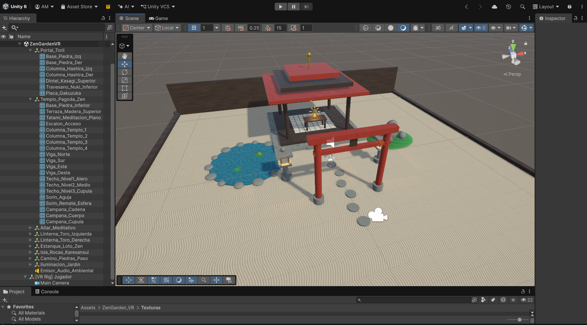
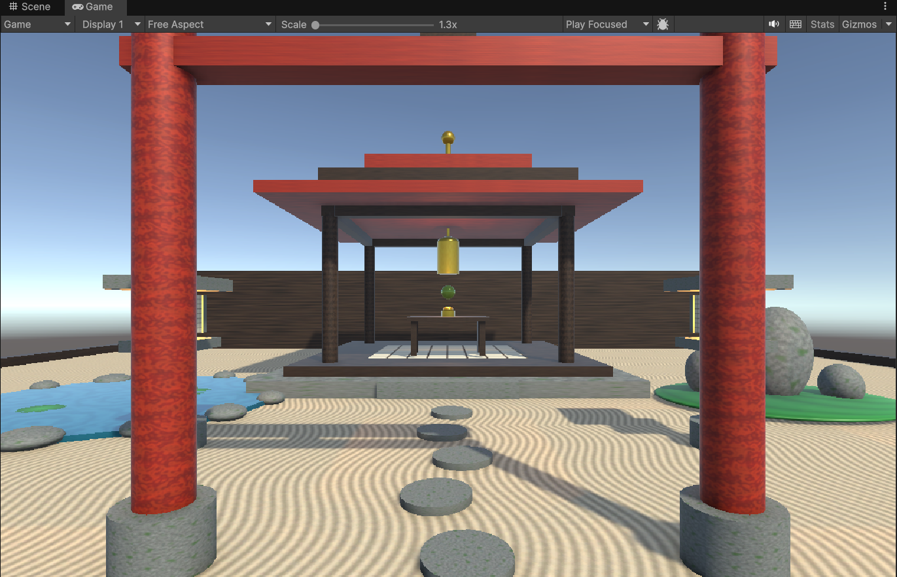

# Zen Garden VR: Immersive Contemplative Sanctuary and Meditative Temple at 1:1 Human Scale

**Peer Review Submission Document**  
**Course:** Advanced Virtual Reality in Unity  
**Development Environment:** Unity 6 / Universal Render Pipeline (URP)  
**XR Standard:** OpenXR / Unity Input System (`TrackedPoseDriver`)  

---

## 1. Project Title

> **Zen Garden VR: Japanese Contemplative Sanctuary and Meditative Temple at 1:1 Human Scale**

<p align="center">
  
</p>

---

## 2. Brief Scene Description

This project showcases an **imaginary and contemplative 3D environment** inspired by traditional Japanese dry landscape gardens (*Karesansui*) and sacred Buddhist/Shinto temple architecture. The spatial composition is engineered specifically to foster mindfulness, deep relaxation, and spatial presence in Virtual Reality.

### Architectural and Spatial Composition:
1. **Central Zen Sand Garden (*Karesansui*):** An expansive $24\times24\text{ m}$ gravel courtyard featuring procedural sinusoidal rake grooves, enclosed by dark teak boundary beams and a contemplative rear boundary wall.
2. **Stepping Stones Path (*Tobi-Ishi*):** A sequence of seven polished stone slabs guiding visual attention and natural movement from the user's initial spawn point toward the sanctuary.
3. **Ceremonial Torii Gate:** A traditional $3.8\text{ m}$ portal demarcating the transition from the mundane to sacred space, comprising cylindrical stone pedestals (*Kamebara*), twin vermilion cedar pillars (*Hashira*), a curved upper lintel (*Kasagi*), a secondary tie-beam (*Nuki*), and a central tablet (*Gakuzuka*).
4. **Three-Tiered Meditative Pagoda:** A $7.2\times7.2\text{ m}$ foundation structure with stepped stone and wood terracing, ceremonial tatami matting, four structural pillars, crossbeam grid, multi-tiered flared eaves, a sacred bronze spire (*Sōrin*) with a golden sphere finial, and a suspended meditation temple bell (*Bonshō*).
5. **Central Meditation Altar:** An elevated offering table ($0.85\text{ m}$ height) featuring a bronze incense burner (*Kōrō*), warm accent illumination, and a **floating spiritual crystal orb** with emissive properties executing smooth continuous Y-axis rotation.
6. **Twin Japanese Stone Lanterns (*Tōrō*):** Symmetrically placed flanking lanterns consisting of a base (*Kiso*), shaft (*Sao*), intermediate platform (*Chūdai*), translucent Shoji paper light chamber (*Hibukuro*) housing internal warm point lights, umbrella roof (*Kasa*), and jewel finial (*Hōju*).
7. **Lotus and Koi Reflective Pond:** A $5\text{ m}$ diameter circular water basin bordered by 14 natural perimeter stones, floating lotus pads, and a sacred blooming lotus flower.
8. **Zen Rock Arrangement (*Iwakura*):** An organic moss mound supporting a classical triad of weathered granite meditation stones (Father Stone, Guardian Stone, and Child Stone) oriented with natural asymmetry.

---

## 3. Detailed Instructions for Evaluators

Please follow these steps to load, inspect, and experience the scene:

### Step 1: Open the Project in Unity Hub
1. Launch **Unity Hub**.
2. Click **Add** > **Add project from disk** and select the unzipped project root directory.
3. Open the project using **Unity 6 (6000.x)** or **Unity 2022.3 LTS / 2023.x** configured with the Universal Render Pipeline (URP).
4. Allow Unity to finish compiling and importing packages.

### Step 2: Load the Evaluation Scene
1. In the **Project** window (bottom panel), navigate to:
   ```text
   Assets / Scenes / ZenGardenVR.unity
   ```
2. Double-click **`ZenGardenVR.unity`** to open the scene.  
   *(Backup Notice: If you wish to regenerate the entire scene from scratch at any moment, use the top menu bar: `Herramientas VR` > `Generar Escena Completa`).*

### Step 3: Verify OpenXR Configuration
1. In the top menu bar, select **Edit** > **Project Settings...**
2. In the left navigation pane, select **XR Plug-in Management**.
3. Under the desktop monitor tab (**Windows, Mac, Linux settings**):
   * Confirm that the **OpenXR** checkbox is enabled / checked.
   * *(Optional)* Expand the **OpenXR** sub-item under *XR Plug-in Management* to confirm enabled interaction profiles (e.g., *Oculus Touch Controller Profile*, *HTC Vive Controller Profile*, or *Eye Gaze / Head Pose Interaction*).

### Step 4: Enter Play Mode and Test
1. Click the **Play (▶)** button located in the top-center toolbar.
2. Immediate verification checks:
   * **Head Tracking:** When using a VR headset or the Unity XR Device Simulator, move your head/view to verify 6DoF rotational and positional tracking handled by the `TrackedPoseDriver` component.
   * **Procedural Animation:** Observe the meditation crystal orb hovering above the altar rotating smoothly around its vertical Y-axis.
   * **Ambient Audio:** You will immediately hear the synthetic harmonic Tibetan singing bowl ambient drone looping seamlessly (calibrating fundamental frequencies: 216 Hz, 432 Hz, and 648 Hz).
3. To exit the evaluation, click **Play (▶)** again.

---

## 4. Hardware Constraints

> **Important Notice for Evaluators: A physical Virtual Reality headset is NOT required to evaluate this project.**

* **Evaluation without Hardware Restrictions (Editor Mode / Standard Display):**
  * The scene is fully functional and evaluable on any standard computer directly through the Unity Editor's **Scene** and **Game** views.
  * Upon pressing **Play (▶)**, the camera positions automatically at human eye level ($1.65\text{ m}$), the `RotadorSuave` animation script executes in real-time, and ambient audio plays through standard computer speakers or headphones.
  * Evaluators with the *XR Device Simulator* package enabled can freely simulate head rotation and movement via mouse and keyboard (right-click + WASD).

* **Evaluation with Physical VR Hardware (Optional):**
  * If a tethered or wireless PC VR headset is available (**Meta Quest 2 / 3 / Pro** via Quest Link, AirLink, or Virtual Desktop; **HTC VIVE / Cosmos**; **Valve Index**; or **Windows Mixed Reality**), the scene connects automatically upon entering Play mode through OpenXR and `TrackedPoseDriver`, providing full stereoscopic 1:1 immersion.

---

## 5. Technical Rubric Justification

| Rubric Criteria | Project Implementation | Technical Justification |
| :--- | :--- | :--- |
| **1. Multiple 3D Primitives** | Cubes, Cylinders, Spheres, and Planes harmoniously combined. | **Planes:** Zen sand courtyard surface ($24\times24\text{ m}$) and ceremonial tatami mat.<br>**Cubes:** Stepped stone foundations, structural beams, Torii lintels/crossbeams, walls, and altar legs.<br>**Cylinders:** Temple columns, Torii pillars, lantern shafts, bell body, and circular pond basin.<br>**Spheres:** Natural garden boulders, lantern domes, *Hōju* finials, incense vessel, and sacred lotus bud. |
| **2. Hierarchical Transformations via Empty Parent GameObjects** | Strict modular organization under empty GameObjects as local roots. | Every composite structure (`Portal_Torii`, `Templo_Pagoda_Zen`, `Altar_Meditativo`, `Linterna_Toro_Izquierda`, `Linterna_Toro_Derecha`, `Estanque_Loto_Zen`, `Isla_Rocas_Karesansui`, `Camino_Piedras_Paso`, `[VR Rig] Jugador`) is parented under an empty GameObject. This allows moving, rotating, or scaling the entire pagoda, altar, or Torii gate atomically by altering only the parent's `Transform`, preserving internal relative offsets without breaking child alignments. |
| **3. Materials with Mapped Textures** | 8 Procedural PBR textures with UV tiling. | A dedicated procedural generator (`Texture2D`) creates and saves native PNG assets to disk (`Assets/ZenGarden_VR/Texturas/`): raked sand waves, red cedar grain, dark teak, mossy stone, water caustics, Shoji lattice paper, brushed gold, and lotus foliage. All materials configure full PBR properties (*Base Color*, *Base Map*, *Metallic*, *Smoothness*, and *Emission*) with metric tiling factors. |
| **4. Human Scale for VR (1:1 in Meters)** | 1 Unity Unit = 1 Real-world Meter.<br>Human eye height = 1.65 m. | All architecture strictly follows ergonomic architectural proportions: Torii height is $3.8\text{ m}$, altar table sits at $0.85\text{ m}$, steps measure $0.15\text{ m}$, and lanterns stand at $2.1\text{ m}$. The camera rig (`[VR Rig] Jugador`) places the `Main Camera` at an exact local height of **$Y = 1.65\text{ m}$** (human eye-level average), coupled with the standard **`TrackedPoseDriver`** component for 6DoF tracking. |
| **5. Lighting and Soft Shadows** | Directional Light + Warm ornamental Point Lights. | The environment uses a primary `Directional Light` (`Sol_Meditativo_VR`) set at $46^\circ$ with a serene warm morning color ($1.0, 0.96, 0.88$) and **Soft Shadows** enabled. In addition, three warm **Point Lights** with soft shadows provide localized illumination: two inside the stone lanterns ($4.5\text{ m}$ radius) and one above the altar incense burner. |
| **6. Optional Extras (Animation & Audio)** | `RotadorSuave.cs` script + Procedural WAV audio loop. | **Animation:** The altar's spiritual crystal incorporates the [`RotadorSuave.cs`]() component, applying smooth Y-axis rotation ($30^\circ/\text{s}$).<br>**Audio:** A dedicated `Emisor_Audio_Ambiental` GameObject with an `AudioSource` continuously loops a synthesized 16-bit PCM WAV Tibetan singing bowl harmonic tone without external dependencies. |

---

## 6. Project Screenshots and Submission Captions

### Visual Gallery of the Project in Unity

| Immersive 1:1 Scale Overview | Hierarchy & Inspector (TrackedPoseDriver) |
| :---: | :---: |
|  |  |

---

### Caption for the Project Screenshot

> **Filename:** `Screenshot_ZenGardenVR_Inspector.png` (or `Screenshots/Inspector_VR.png`)  
> **Image Caption / Notes:**  
> *"Full Unity Editor overview displaying the `ZenGardenVR.unity` scene. The Scene view illustrates the 1:1 scale immersive perspective of the Zen garden captured from the human eye level ($Y = 1.65\text{ m}$), showing the Torii portal, stepping stone path, illuminated stone lanterns, reflective lotus pond, and meditative pagoda in the background bathed in soft morning sunlight. The Hierarchy window shows the strict modular organization via empty parent GameObjects, while the Inspector highlights the Main Camera configuration with the TrackedPoseDriver component and the calibrated 1.65-meter eye height."*

---

### Caption for the Compressed ZIP Archive

> **Filename:** `ZenGardenVR_PeerReview_Submission.zip`  
> **Submission Caption / Notes:**  
> *"This compressed ZIP archive contains the complete, canonical Unity project structure required for evaluation: the `Assets` folder (including scene files, editor/runtime scripts, textures, and materials), `Packages` (URP, Input System, and XR dependencies manifest), and `ProjectSettings` (quality, physics, tags, and OpenXR configuration). Local transient folders (`Library`, `Temp`, `Logs`, `Builds`) have been purposefully excluded to avoid data redundancy, ensure optimal download speed, and guarantee a clean, reproducible import on the evaluator's machine."*
